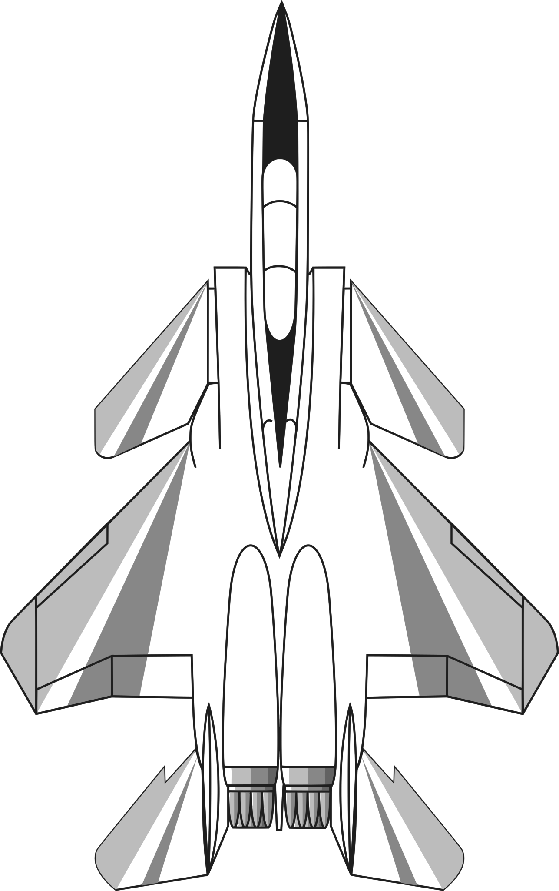

<div align="center">
  <a href="https://github.com/hlongit">
    
  </a>
</div>

<div align="center">
  
</div>

<div align="center">

### `$ whoami`

</div>

```ts
const hlong = {
  name:      "HLong",
  pronouns:  "he/him",
  handle:    "hlongit",
  school:    "VNU-HCMUT — IET-08",
  major:     ["Software Engineering", "Artificial Intelligence"],
  site:      "https://rhikaku.net/",
  nerdAbout: ["aviation", "virtual companion", "reinforcement learning", "plugin architecture"],
  quote:"there's a fine line between bravery and stupidity, and half of the time, i'm the latter",
} as const;
```

<div align="center">


[](https://rihikaku.net/)
[](https://github.com/hlongit)
[](#)

<a href="https://git.io/typing-svg">
  
</a>

</div>

<div align="center">
  
</div>

## &nbsp;⚡&nbsp; Tech I reach for

<div align="center">


</div>

## &nbsp;📊&nbsp; By the numbers

<div align="center">

<a href="https://github.com/hlongit">
  
</a>
<a href="https://github.com/hlongit">
  
</a>

<br>

<a href="https://github.com/hlongit">
  
</a>

</div>

## &nbsp;🛩️&nbsp; Off the clock

<div align="center">

<a href="https://commons.wikimedia.org/wiki/File:McDonnell_F-15A_DraftSight.svg">
  
</a>

<sub><i>McDonnell-Douglas F-15A — three-view. "McDonnell F-15A DraftSight" by
<a href="https://commons.wikimedia.org/wiki/User:Kaboldy">Kaboldy</a>, via Wikimedia Commons,
licensed <a href="https://creativecommons.org/licenses/by-sa/4.0/">CC BY-SA 4.0</a>.
Modified: background removed, line art recoloured, strokes adjusted.
See <a href="./ATTRIBUTION.md">ATTRIBUTION.md</a>.</i></sub>

</div>

<table>
<tr>
<td valign="top" width="50%">

**The F-15 Eagle.** Twin-engine, twin-tail, undefeated air-to-air record. A 1960s airframe that is *still* the benchmark. There is a lesson in there about engineering margins ~ and about what "good enough" means when the customer is a pilot.

</td>
<td valign="top" width="50%">



**Reinforcement learning.** Reading papers, re-running experiments, and occasionally being humbled by a benchmark that a 12-year-old would clear.

</td>
</tr>
</table>

<div align="center">
  
</div>

<div align="center">
  <sub><b>Thanks for stopping by.</b> Find me at <a href="https://rihikaku.net/">rihikaku.net</a> · <code>he/him</code></sub>
  <br><br>
  <sub><i>Banner, divider and ring are generated by <code>scripts/generate-assets.mjs</code>; the aircraft
  artwork by <code>scripts/build-jet-assets.mjs</code>. Third-party credits and licences are in
  <a href="./ATTRIBUTION.md">ATTRIBUTION.md</a>.</i></sub>
</div>
